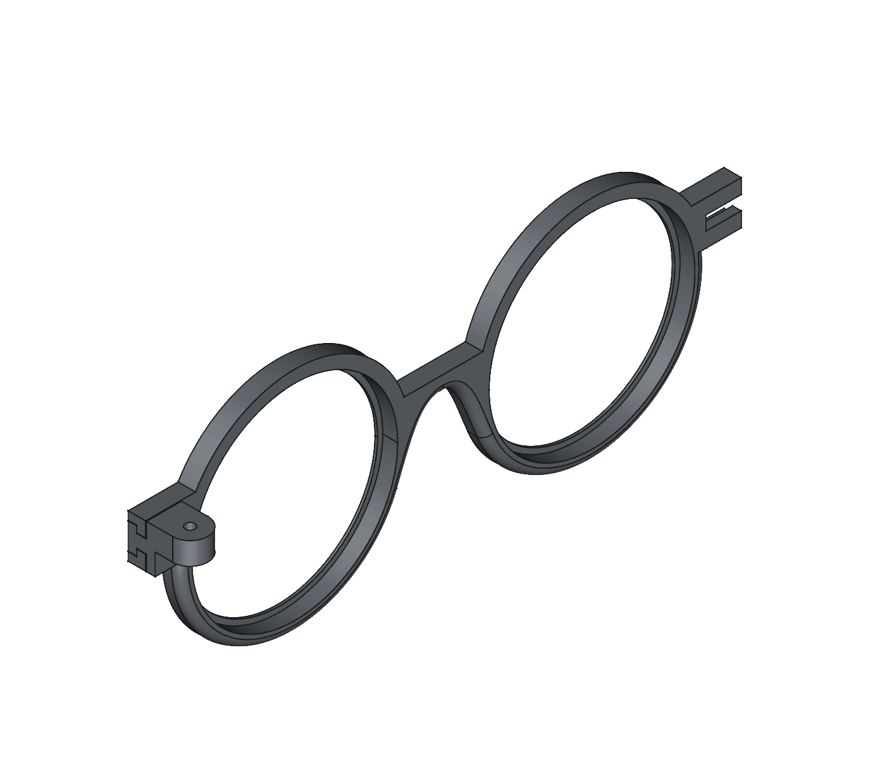
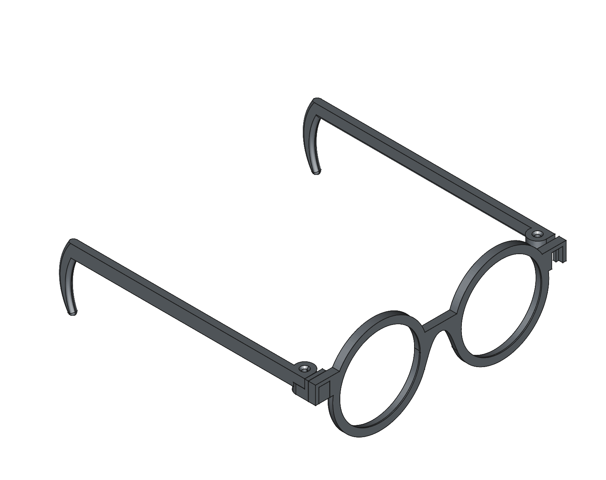
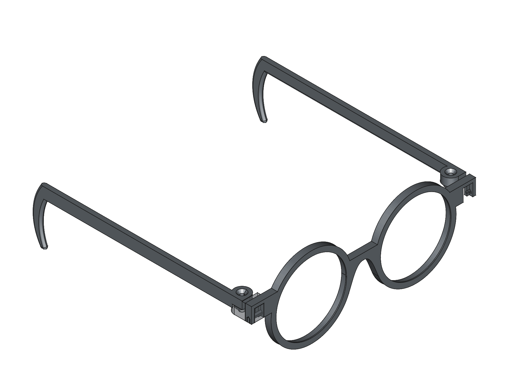
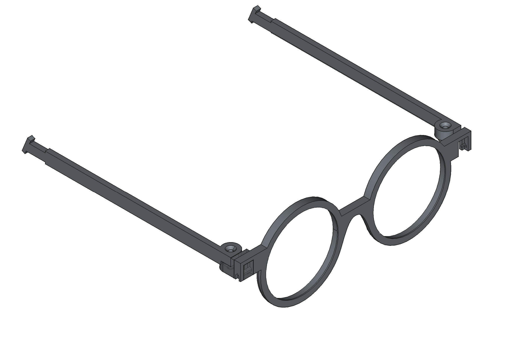

# Version 1 (inaccessible)

-   Created version with sideways interlocking mechanism
-   Friction-fit mechanism devised
-   Not the best. The hinge worked fine, but any pressure from the sides of the glasses would cause the glasses to dismantle

# Version 2 (inaccessible)

-   Improved the granularity of tolerances to allow better hinge movement and less issues with the interlock sizing
-   Added additional chamfers to assist with hear inserting the screw threads
-   Added magnets to small 1mm magnets to interlock mechanism (improved reliability, but the magnet size constraints still caused issues)

# Version 3 (stable)

-   More improvements to tolerances
-   Fixed issues with model binding issues (FreeCAD issue)
-   Swapped to pin interconnect system, optimized for 3d printing

# Version 4 (wip)

-   Added adjustable sweep across the bottom of the frame
-   Added new new temple variants designed specifically for rubber/TPU ear hooks

**Still pending**

-   Lens alignment helpers - being able to swap lenses on a whim while not needing a manual alignment step is still a WIP. This will make using third party lenses less effective, so I might need to have a new variant specifically for this.
-   Accessories - Special attachments are still WIP. The snap-fit mechanism works best when the snaps are printed separately than the covers because of grain.

